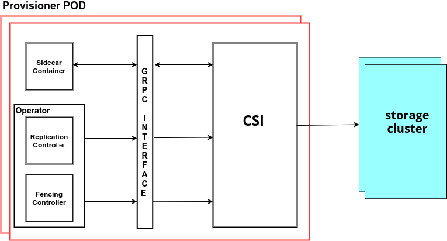

# CSI-Addons Operation: VolumeReplication

## Notational Conventions

The keywords "MUST", "MUST NOT", "REQUIRED", "SHALL", "SHALL NOT", "SHOULD",
"SHOULD NOT", "RECOMMENDED", "NOT RECOMMENDED", "MAY", and "OPTIONAL" are to be
interpreted as described in [RFC 2119](https://tools.ietf.org/html/rfc2119).

## Terminology

| Term     | Definition                                                                            |
| -------- | ------------------------------------------------------------------------------------- |
| VolumeID | The identifier of the volume generated by the plugin.                                 |
| CO       | Container Orchestration system that communicates with plugins using CSI service RPCs. |
| SP       | Storage Provider, the vendor of a CSI plugin implementation.                          |
| DR       | Disaster Recovery.                                                                    |
| RPC      | [Remote Procedure Call](https://en.wikipedia.org/wiki/Remote_procedure_call).         |

## Objective

Define a standard that will enable storage vendors (SP) to develop
controllers/plugins for DR or to talk to the different CO systems.

### Goals in MVP

The new standard will

* Provide API at volume level granularity.
* Enable SP authors to write one replication compliant plugin that “just works”
  across all COs that implement RPC.
* Define API (RPCs) that enable:
  * Enable/Disable volume replication.
  * Promote/Demote volume.
  * Resync volume to solve the issue before using the volume.

### Non-Goals in MVP

* Replication at different granular levels
* Replication of volume snapshots.

## Solution Overview

This specification defines an interface along with the minimum operational and
packaging recommendations for a storage provider (SP) to implement a
Replication compatible plugin. The interface declares the RPCs that a plugin
MUST expose.

## Architecture



## Error Handling

All RPCs defined in this specification return a standard
[gRPC status](https://github.com/grpc/grpc/blob/master/src/proto/grpc/status/status.proto).
The status `code` MUST be a
[canonical gRPC error code](https://github.com/grpc/grpc-go/blob/master/codes/codes.go);
the CO MUST handle all valid error codes. When the `code` is not `OK`, the status
`message` MUST contain a human-readable description of the error, which MAY be
surfaced by the CO to end users. The status `details` MUST be empty.

Each RPC below documents, in its Errors table, the gRPC codes the Plugin returns
for the listed conditions and the recovery behavior the caller is expected to
implement.

The following error codes are common to all RPCs in this specification. In
addition to the conditions below, each RPC MAY define further codes in its own
Errors section.

| Condition | gRPC Code | Description | Recovery Behavior |
| --------- | --------- | ----------- | ----------------- |
| Missing required field | 3 INVALID_ARGUMENT | Indicates that a required field is missing from the request. | Caller MUST fix the request by adding the missing required field before retrying. |
| Invalid or unsupported field in the request | 3 INVALID_ARGUMENT | Indicates that one or more fields in the request is either not allowed by the Plugin or has an invalid value. | Caller MUST fix the field before retrying. |
| Operation pending | 10 ABORTED | Indicates that there is already an operation pending for the specified resource. The Plugin SHOULD handle this as gracefully as possible, and MAY return this error code to reject secondary calls. | Caller SHOULD ensure that there are no other calls pending for the specified resource, and then retry with exponential back off. |
| Call not implemented | 12 UNIMPLEMENTED | The invoked RPC is not implemented by the Plugin or disabled in its current mode of operation. | Caller MUST NOT retry. |
| Not authenticated | 16 UNAUTHENTICATED | The invoked RPC does not carry secrets that are valid for authentication. | Caller SHALL either fix the secrets provided in the RPC, or otherwise regalvanize said secrets such that they pass authentication by the Plugin for the attempted RPC, after which point the caller MAY retry the attempted RPC. |
| Error is Unknown | 2 UNKNOWN | Indicates that an unknown error occurred. | Caller MUST study the logs before retrying. |

## RPC Interface

* **Controller Service**: The Controller plugin MUST implement these sets of
  RPCs.

Throughout this specification, each RPC identifies its target by the
`replication_source` field, which carries the id of the volume or volume group to
operate on. The `replication_id` field is OPTIONAL: a caller MAY set it to
uniquely identify the specific replication, and a Plugin MUST NOT require it.

```protobuf
syntax = "proto3";
package replication;

import "github.com/container-storage-interface/spec/lib/go/csi/csi.proto";
import "google/protobuf/descriptor.proto";
import "google/protobuf/duration.proto";
import "google/protobuf/timestamp.proto";

option go_package = ".;replication";

extend google.protobuf.FieldOptions {
  // Indicates that this field is OPTIONAL and part of an experimental
  // API that may be deprecated and eventually removed between minor
  // releases.
  bool alpha_field = 1100;
}

// Controller holds the RPC methods for replication and all the methods it
// exposes should be idempotent.
service Controller {
  // EnableVolumeReplication RPC call to enable the volume replication.
  rpc EnableVolumeReplication (EnableVolumeReplicationRequest)
  returns (EnableVolumeReplicationResponse) {}
  // DisableVolumeReplication RPC call to disable the volume replication.
  rpc DisableVolumeReplication (DisableVolumeReplicationRequest)
  returns (DisableVolumeReplicationResponse) {}
  // PromoteVolume RPC call to promote the volume.
  rpc PromoteVolume (PromoteVolumeRequest)
  returns (PromoteVolumeResponse) {}
  // DemoteVolume RPC call to demote the volume.
  rpc DemoteVolume (DemoteVolumeRequest)
  returns (DemoteVolumeResponse) {}
  // ResyncVolume RPC call to resync the volume.
  rpc ResyncVolume (ResyncVolumeRequest)
  returns (ResyncVolumeResponse) {}
  // GetVolumeReplicationInfo RPC call to get the volume replication
  // information.
  rpc GetVolumeReplicationInfo (GetVolumeReplicationInfoRequest)
  returns (GetVolumeReplicationInfoResponse) {}
  // GetReplicationDestinationInfo RPC call to get the destination
  // volume or volume group details for an existing replication.
  rpc GetReplicationDestinationInfo (GetReplicationDestinationInfoRequest)
  returns (GetReplicationDestinationInfoResponse) {}
}
```

### EnableVolumeReplication

A Controller Plugin MUST implement this RPC call if it has the `VolumeReplication`
`VOLUME_REPLICATION` capability (see the [Identity](../identity/README.md)
service). This RPC is called by the CO to enable replication on the volume or
volume group identified by `replication_source`. This operation MUST be
idempotent. If replication is already enabled for the `replication_source` and is
compatible with the request, the Plugin MUST reply `0 OK`. If the operation fails,
or the CO does not know whether it succeeded, it MAY call `EnableVolumeReplication`
again.

```protobuf
// EnableVolumeReplicationRequest holds the required information to enable
// replication on a volume.
message EnableVolumeReplicationRequest {
  // Deprecated "volume_id".
  reserved 1;
  reserved "volume_id";
  // Plugin specific parameters passed in as opaque key-value pairs.
  map<string, string> parameters = 2;
  // Secrets required by the plugin to complete the request.
  map<string, string> secrets = 3 [(csi.v1.csi_secret) = true];
  // This field is OPTIONAL.
  // This field MUST contain enough information to uniquely identify
  // this specific replication
  // vs all other replications supported by this plugin.
  string replication_id = 4 [(alpha_field) = true];
  // If specified, this field will contain volume or volume group id
  // for replication.
  ReplicationSource replication_source = 5;
}

// EnableVolumeReplicationResponse holds the information to send when
// replication is successfully enabled on a volume.
message EnableVolumeReplicationResponse {
}
```

#### EnableVolumeReplication Errors

If the Plugin is unable to complete the requested operation successfully, it MUST
return a non-ok gRPC code in the gRPC status. If the conditions defined below are
encountered, the Plugin MUST return the specified gRPC error code. The CO MUST
implement the specified error recovery behavior when it encounters the gRPC error
code.

| Condition                    | gRPC Code          | Description                                                                                                                                                                                                                                                                                                                                                                                                                                                                                                                               | Recovery Behavior                                                                                                                                                                                                                     |
| ---------------------------- | ------------------ | ----------------------------------------------------------------------------------------------------------------------------------------------------------------------------------------------------------------------------------------------------------------------------------------------------------------------------------------------------------------------------------------------------------------------------------------------------------------------------------------------------------------------------------------- | ------------------------------------------------------------------------------------------------------------------------------------------------------------------------------------------------------------------------------------- |
| Replication Source does not exist        | 5 NOT_FOUND        | Indicates that the specified source does not exist.                                                                                                                                                                                                                                                                                                                                                                                                                                                        | Caller MUST verify that the `replication_source` is correct, the source is accessible, and has not been deleted before retrying with exponential back off.                                                                              |
| Replication Source cannot be enabled | 9 FAILED_PRECONDITION | Indicates that replication could not be enabled for the specified `replication_source` due to a failed precondition (for example the source is not in a state that allows replication to be enabled). | Caller SHOULD ensure that the `replication_source` meets the requirements for enabling replication. |

### DisableVolumeReplication

A Controller Plugin MUST implement this RPC call if it has the `VolumeReplication`
`VOLUME_REPLICATION` capability. This RPC is called by the CO to disable
replication on the volume or volume group identified by `replication_source`.
This operation MUST be idempotent: disabling replication that is already disabled
MUST reply `0 OK`. If the `replication_source` does not exist, the Plugin MUST
return `NOT_FOUND`, as documented in the Errors table below.

```protobuf
// DisableVolumeReplicationRequest holds the required information to disable
// replication on a volume.
message DisableVolumeReplicationRequest {
  // Deprecated "volume_id".
  reserved 1;
  reserved "volume_id";
  // Plugin specific parameters passed in as opaque key-value pairs.
  map<string, string> parameters = 2;
  // Secrets required by the plugin to complete the request.
  map<string, string> secrets = 3 [(csi.v1.csi_secret) = true];
  // This field is OPTIONAL.
  // This field MUST contain enough information to uniquely identify
  // this specific replication
  // vs all other replications supported by this plugin.
  string replication_id = 4 [(alpha_field) = true];
  // If specified, this field will contain volume or volume group id
  // for replication.
  ReplicationSource replication_source = 5;
}

// DisableVolumeReplicationResponse holds the information to send when
// replication is successfully disabled on a volume.
message DisableVolumeReplicationResponse {
}
```

#### DisableVolumeReplication Errors

If the Plugin is unable to complete the requested operation successfully, it MUST
return a non-ok gRPC code in the gRPC status. If the conditions defined below are
encountered, the Plugin MUST return the specified gRPC error code. The CO MUST
implement the specified error recovery behavior when it encounters the gRPC error
code.

| Condition                    | gRPC Code          | Description                                                                                                                                                                                                                                                                                                                                                                                                                                                                                                                               | Recovery Behavior                                                                                                                                                                                                                     |
| ---------------------------- | ------------------ | ----------------------------------------------------------------------------------------------------------------------------------------------------------------------------------------------------------------------------------------------------------------------------------------------------------------------------------------------------------------------------------------------------------------------------------------------------------------------------------------------------------------------------------------- | ------------------------------------------------------------------------------------------------------------------------------------------------------------------------------------------------------------------------------------- |
| Replication Source does not exist        | 5 NOT_FOUND        | Indicates that the specified source does not exist.                                                                                                                                                                                                                                                                                                                                                                                                                                                        | Caller MUST verify that the `replication_source` is correct, the source is accessible, and has not been deleted before retrying with exponential back off.                                                                              |

### PromoteVolume

A Controller Plugin MUST implement this RPC call if it has the `VolumeReplication`
`VOLUME_REPLICATION` capability. This RPC is called by the CO to promote the
volume or volume group identified by `replication_source` to the primary role on
the local cluster, so that it can be used by a workload. This operation MUST be
idempotent. If the `replication_source` is already primary and compatible with the
request, the Plugin MUST reply `0 OK`. The optional `force` flag MAY be set to
force promotion when the Plugin would otherwise reject it due to a failed
precondition.

```protobuf
// PromoteVolumeRequest holds the required information to promote volume as a
// primary on local cluster.
message PromoteVolumeRequest {
  // Deprecated "volume_id".
  reserved 1;
  reserved "volume_id";
  // This field is optional.
  // Default value is false, force option to Promote the volume.
  bool force = 2;
  // Plugin specific parameters passed in as opaque key-value pairs.
  map<string, string> parameters = 3;
  // Secrets required by the plugin to complete the request.
  map<string, string> secrets = 4 [(csi.v1.csi_secret) = true];
  // This field is OPTIONAL.
  // This field MUST contain enough information to uniquely identify
  // this specific replication
  // vs all other replications supported by this plugin.
  string replication_id = 5 [(alpha_field) = true];
  // If specified, this field will contain volume or volume group id
  // for replication.
  ReplicationSource replication_source = 6;
}

// PromoteVolumeResponse holds the information to send when
// volume is successfully promoted.
message PromoteVolumeResponse{
}
```

#### PromoteVolume Errors

If the Plugin is unable to complete the requested operation successfully, it MUST
return a non-ok gRPC code in the gRPC status. If the conditions defined below are
encountered, the Plugin MUST return the specified gRPC error code. The CO MUST
implement the specified error recovery behavior when it encounters the gRPC error
code.

| Condition                    | gRPC Code             | Description                                                                                                                                                                                                                                                                                                                                                                                                                                                                                                                               | Recovery Behavior                                                                                                                                                                                                                     |
| ---------------------------- | --------------------- | ----------------------------------------------------------------------------------------------------------------------------------------------------------------------------------------------------------------------------------------------------------------------------------------------------------------------------------------------------------------------------------------------------------------------------------------------------------------------------------------------------------------------------------------- | ------------------------------------------------------------------------------------------------------------------------------------------------------------------------------------------------------------------------------------- |
| Replication Source does not exist        | 5 NOT_FOUND        | Indicates that the specified source does not exist.                                                                                                                                                                                                                                                                                                                                                                                                                                                        | Caller MUST verify that the `replication_source` is correct, the source is accessible, and has not been deleted before retrying with exponential back off.                                                                              |
| Replication Source is not replicated     | 9 FAILED_PRECONDITION | Indicates that the Source corresponding to the specified `replication_source` could not be promoted due to failed precondition (for example replication is not enabled or Source cannot be promoted without force option).                                                                                                                                                                                                                                                                                                                         | Caller SHOULD ensure that replication is enabled.                                                                                                                                                                                     |

### DemoteVolume

A Controller Plugin MUST implement this RPC call if it has the `VolumeReplication`
`VOLUME_REPLICATION` capability. This RPC is called by the CO to demote the volume
or volume group identified by `replication_source` to the secondary role on the
local cluster. This operation MUST be idempotent. If the `replication_source` is
already secondary, the Plugin MUST reply `0 OK`. The optional `force` flag MAY be
set to force demotion.

```protobuf
// DemoteVolumeRequest holds the required information to demote volume on local
// cluster.
message DemoteVolumeRequest {
  // Deprecated "volume_id".
  reserved 1;
  reserved "volume_id";
  // This field is optional.
  // Default value is false, force option to Demote the volume.
  bool force = 2;
  // Plugin specific parameters passed in as opaque key-value pairs.
  map<string, string> parameters = 3;
  // Secrets required by the plugin to complete the request.
  map<string, string> secrets = 4 [(csi.v1.csi_secret) = true];
  // This field is OPTIONAL.
  // This field MUST contain enough information to uniquely identify
  // this specific replication
  // vs all other replications supported by this plugin.
  string replication_id = 5 [(alpha_field) = true];
  // If specified, this field will contain volume or volume group id
  // for replication.
  ReplicationSource replication_source = 6;
}

// DemoteVolumeResponse holds the information to send when
// volume is successfully demoted.
message DemoteVolumeResponse{
}
```

#### DemoteVolume Errors

If the Plugin is unable to complete the requested operation successfully, it MUST
return a non-ok gRPC code in the gRPC status. If the conditions defined below are
encountered, the Plugin MUST return the specified gRPC error code. The CO MUST
implement the specified error recovery behavior when it encounters the gRPC error
code.

| Condition                    | gRPC Code             | Description                                                                                                                                                                                                                                                                                                                                                                                                                                                                                                                               | Recovery Behavior                                                                                                                                                                                                                     |
| ---------------------------- | --------------------- | ----------------------------------------------------------------------------------------------------------------------------------------------------------------------------------------------------------------------------------------------------------------------------------------------------------------------------------------------------------------------------------------------------------------------------------------------------------------------------------------------------------------------------------------- | ------------------------------------------------------------------------------------------------------------------------------------------------------------------------------------------------------------------------------------- |
| Replication Source does not exist        | 5 NOT_FOUND           | Indicates that the specified source does not exist.                                                                                                                                                                                                                                                                                                                                                                                                                                                        | Caller MUST verify that the `replication_source` is correct, the source is accessible, and has not been deleted before retrying with exponential back off.                                                                              |
| Replication Source is not replicated     | 9 FAILED_PRECONDITION | Indicates that the Replication Source corresponding to the specified `replication_source` could not be demoted due to failed precondition (for example replication is not enabled).                                                                                                                                                                                                                                                                                                                                                                            | Caller SHOULD ensure that replication is enabled.                                                                                                                                                                                     |

### ResyncVolume

A Controller Plugin MUST implement this RPC call if it has the `VolumeReplication`
`VOLUME_REPLICATION` capability. This RPC is called by the CO to resynchronize the
volume or volume group identified by `replication_source` with its peer after a
failover, so that it is consistent and can be used again. This operation MUST be
idempotent. The `ready` field in the response indicates whether the
`replication_source` is consistent and ready to use; while `ready` is `false` the
CO SHOULD reissue `ResyncVolume` until it becomes `true`. The optional `force`
flag MAY be set.

```protobuf
// ResyncVolumeRequest holds the required information to resync volume.
message ResyncVolumeRequest {
  // Deprecated "volume_id".
  reserved 1;
  reserved "volume_id";
  // This field is optional.
  // Default value is false, force option to Resync the volume.
  bool force = 2;
  // Plugin specific parameters passed in as opaque key-value pairs.
  map<string, string> parameters = 3;
  // Secrets required by the plugin to complete the request.
  map<string, string> secrets = 4 [(csi.v1.csi_secret) = true];
  // This field is OPTIONAL.
  // This field MUST contain enough information to uniquely identify
  // this specific replication
  // vs all other replications supported by this plugin.
  string replication_id = 5 [(alpha_field) = true];
  // If specified, this field will contain volume or volume group id
  // for replication.
  ReplicationSource replication_source = 6;
}

// ResyncVolumeResponse holds the information to send when
// volume is successfully resynced.
message ResyncVolumeResponse{
  // Indicates that the volume is ready to use.
  // The default value is false.
  // This field is REQUIRED.
  bool ready = 1;
}
```

#### ResyncVolume Errors

If the Plugin is unable to complete the requested operation successfully, it MUST
return a non-ok gRPC code in the gRPC status. If the conditions defined below are
encountered, the Plugin MUST return the specified gRPC error code. The CO MUST
implement the specified error recovery behavior when it encounters the gRPC error
code.

| Condition                                        | gRPC Code             | Description                                                                                                                                                                                                                                                                                                                                                                                                                                                                                                                               | Recovery Behavior                                                                                                                                                                                                                     |
| ------------------------------------------------ | --------------------- | ----------------------------------------------------------------------------------------------------------------------------------------------------------------------------------------------------------------------------------------------------------------------------------------------------------------------------------------------------------------------------------------------------------------------------------------------------------------------------------------------------------------------------------------- | ------------------------------------------------------------------------------------------------------------------------------------------------------------------------------------------------------------------------------------- |
| Replication Source does not exist                            | 5 NOT_FOUND           | Indicates that the specified source does not exist.                                                                                                                                                                                                                                                                                                                                                                                                                                                        | Caller MUST verify that the `replication_source` is correct, the source is accessible, and has not been deleted before retrying with exponential back off.                                                                              |
| Replication Source is not replicated or Replication Source is not demoted | 9 FAILED_PRECONDITION | Indicates that the `replication_source` could not be resynced due to failed precondition (for example replication is not enabled on `replication_source` or the`replication_source` is not in the demoted state).                                                                                                                                                                                                                                                                                                                                    | Caller SHOULD ensure that Replication is enabled and the Replication Source is demoted.                                                                                                                                                            |

### GetVolumeReplicationInfo

A Controller Plugin MUST implement this RPC call if it has the `VolumeReplication`
`VOLUME_REPLICATION` capability. This RPC is called by the CO to retrieve
replication information such as the last sync time, duration and bytes, and the
current replication status for the volume or volume group identified by
`replication_source`. This is a read-only operation. The response always carries
`last_sync_time` and `status`, and MAY carry `last_sync_duration`,
`last_sync_bytes` and `status_message`.

```protobuf
// GetVolumeReplicationInfoRequest holds the required information to get
// the Volume replication information.
message GetVolumeReplicationInfoRequest {
  // Deprecated "volume_id".
  reserved 1;
  reserved "volume_id";
  // Secrets required by the plugin to complete the request.
  map<string, string> secrets = 2 [(csi.v1.csi_secret) = true];
  // This field is OPTIONAL.
  // This field MUST contain enough information to uniquely identify
  // this specific replication
  // vs all other replications supported by this plugin.
  string replication_id = 3 [(alpha_field) = true];
  // If specified, this field will contain volume or volume group id
  // for replication.
  ReplicationSource replication_source = 4;
}

// GetVolumeReplicationInfoResponse holds the information to send the
// volume replication information.
message GetVolumeReplicationInfoResponse {
  // Holds the last sync time.
  // This field is REQUIRED.
  .google.protobuf.Timestamp last_sync_time = 1;
  // Holds the last sync duration.
  // last_sync_duration states the time taken to sync
  // to execute the last sync operation.
  // This field is OPTIONAL.
  .google.protobuf.Duration last_sync_duration = 2;
  // Holds the last sync bytes.
  // Represents number of bytes transferred
  // with the last synchronization.
  // This field is OPTIONAL.
  // The value of this field MUST NOT be negative.
  int64 last_sync_bytes = 3;
  // Represents the type of replication status that can be returned
  // by a storage vendor.
  enum Status {
    // UNKNOWN indicates that the SP does not know the current
    // replication status.
    UNKNOWN = 0;
    // HEALTHY indicates that the replication is working properly.
    HEALTHY = 1;
    // DEGRADED indicates that the replication has stopped working
    // and it may require user intervention.
    DEGRADED = 2;
    // ERROR indicates that there is an error in replication
    // and it may require user intervention.
    ERROR = 3;
  }
  // Represents the current replication status as reported by
  // the backend storage system.
  // This field is REQUIRED.
  Status status = 4;
  // Contains a human readable message that describes the current
  // state of replication
  // This field is OPTIONAL.
  string status_message = 5;
}
```

#### GetVolumeReplicationInfo Errors

If the Plugin is unable to complete the requested operation successfully, it MUST
return a non-ok gRPC code in the gRPC status. If the conditions defined below are
encountered, the Plugin MUST return the specified gRPC error code. The CO MUST
implement the specified error recovery behavior when it encounters the gRPC error
code.

| Condition                                        | gRPC Code             | Description                                                                                                                                                                                                                                                                                                                                                                                                                                                                                                                               | Recovery Behavior                                                                                                                                                                                                                     |
| ------------------------------------------------ | --------------------- | ----------------------------------------------------------------------------------------------------------------------------------------------------------------------------------------------------------------------------------------------------------------------------------------------------------------------------------------------------------------------------------------------------------------------------------------------------------------------------------------------------------------------------------------- | ------------------------------------------------------------------------------------------------------------------------------------------------------------------------------------------------------------------------------------- |
| Replication Source does not exist or details not found                           | 5 NOT_FOUND           | Indicates that a Replication Source does not exist or details of `replication_source` are not available at the moment.                                                                                                                                                                                                                                                                                                                                                                                                                            | Caller MUST verify that the `replication_source` is correct and that the `replication_source` is accessible and has not been deleted before retrying with exponential back off.                                                                              |
| Replication Source is not replicated or not promoted | 9 FAILED_PRECONDITION | Indicates that the replication information corresponding to the specified `replication_source` could not be retrieved due to failed precondition (for example replication is not enabled or not in the primary state).                                                                                                                                                                                                                                                                                                                                    | Caller SHOULD ensure that replication is enabled on the `replication_source` and it is promoted.                                                                                                                                                            |

### GetReplicationDestinationInfo

A Controller Plugin MUST implement this RPC call if it has the `VolumeReplication`
`GET_REPLICATION_DESTINATION_INFO` capability (see the
[Identity](../identity/README.md) service). This RPC is called by the CO to obtain
the destination volume or volume group details for an existing replication, for
storage systems where the source and destination identifiers differ. This is a
read-only operation. It returns the destination volume or volume group identifiers
on the remote/target cluster. If the destination details are not yet available
(for example replication has not finished establishing), the Plugin MAY return
`UNAVAILABLE` and the CO SHOULD retry with exponential back off.

```protobuf
// GetReplicationDestinationInfoRequest holds the required information to
// get the destination volume or volume group details for an existing
// replication.
message GetReplicationDestinationInfoRequest {
  // Secrets required by the plugin to complete the request.
  map<string, string> secrets = 1 [(csi.v1.csi_secret) = true];
  // The source volume or volume group for which destination
  // details are requested.
  // This field is REQUIRED.
  ReplicationSource replication_source = 2;
}

// GetReplicationDestinationInfoResponse holds the destination volume
// or volume group details for an existing replication.
message GetReplicationDestinationInfoResponse {
  // The destination details for the replication.
  // This field is REQUIRED.
  ReplicationDestination replication_destination = 1;
}

// Specifies the destination details for a replication. One of the
// type fields MUST be specified.
message ReplicationDestination {
  // VolumeDestination contains the destination details for a
  // replicated volume.
  message VolumeDestination {
    // The destination volume ID on the remote/target cluster.
    // This field is REQUIRED.
    string volume_id = 1;
  }
  // VolumeGroupDestination contains the destination details for a
  // replicated volume group.
  message VolumeGroupDestination {
    // The destination volume group ID on the remote/target cluster.
    // This field is REQUIRED.
    string volume_group_id = 1;
    // Mapping of source volume IDs to their corresponding
    // destination volume IDs. Key is source volume_id,
    // value is destination volume_id.
    // This field is OPTIONAL.
    // This map reflects the current group membership at the
    // time of the call, accounting for dynamic group changes.
    // When provided, this map MUST be complete — it MUST
    // contain an entry for every volume currently in the group.
    // If the SP cannot determine the destination ID for all
    // volumes (e.g., newly added volumes have not finished
    // initial sync), the SP MUST return an error instead of
    // a partial map.
    map<string, string> volume_ids = 2;
  }

  oneof type {
    // Volume destination type
    VolumeDestination volume = 1;
    // Volume group destination type
    VolumeGroupDestination volumegroup = 2;
  }
}
```

#### GetReplicationDestinationInfo Errors

If the Plugin is unable to complete the requested operation successfully, it MUST
return a non-ok gRPC code in the gRPC status. If the conditions defined below are
encountered, the Plugin MUST return the specified gRPC error code. The CO MUST
implement the specified error recovery behavior when it encounters the gRPC error
code.

| Condition                                | gRPC Code             | Description                                                                        | Recovery Behavior                                                                                                     |
| ---------------------------------------- | --------------------- | ---------------------------------------------------------------------------------- | --------------------------------------------------------------------------------------------------------------------- |
| Replication Source does not exist        | 5 NOT_FOUND           | The specified source does not exist.                                               | Caller MUST verify that the `replication_source` is correct and accessible before retrying with exponential back off. |
| Replication Source is not replicated     | 9 FAILED_PRECONDITION | Destination information could not be retrieved because replication is not enabled. | Caller SHOULD ensure that replication is enabled on the `replication_source`.                                         |
| Destination info not yet available       | 14 UNAVAILABLE        | Destination details are not yet available. The SP needs time after replication.    | Caller SHOULD retry with exponential back off. This is transient and resolves once replication is fully established.  |

### ReplicationSource

`ReplicationSource` identifies the entity a replication operation acts on — either
a single volume or a volume group. It is passed to every replication RPC.

```protobuf
// Specifies what source the replication will be created from. One of the
// type fields MUST be specified.
message ReplicationSource {
  // VolumeSource contains the details about the volume to be replication
  message VolumeSource {
    // Contains identity information for the existing volume.
    // This field is REQUIRED.
    string volume_id = 1;
  }
  // VolumeGroupSource contains the details about
  // the volume group to be replication
  message VolumeGroupSource {
    // Contains identity information for the existing volume group.
    // This field is REQUIRED.
    string volume_group_id = 1;
  }

  oneof type {
    // Volume source type
    VolumeSource volume = 1;
    // Volume group source type
    VolumeGroupSource volumegroup = 2;
  }
}
```
